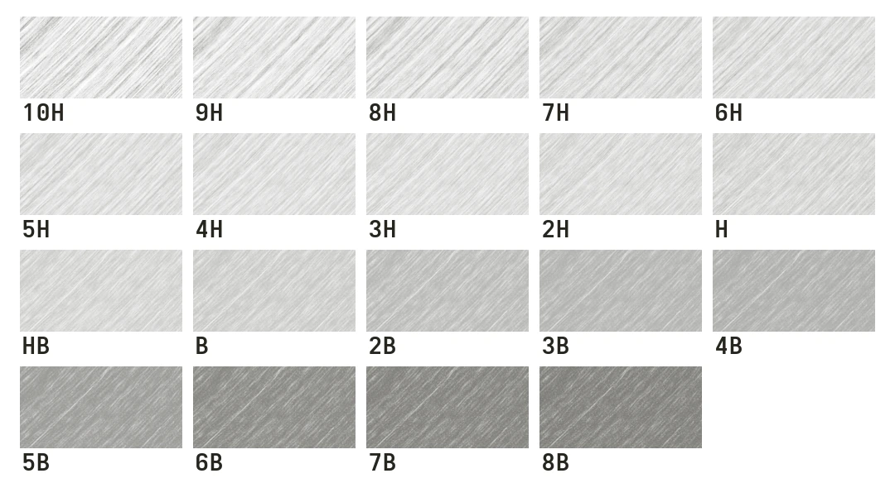
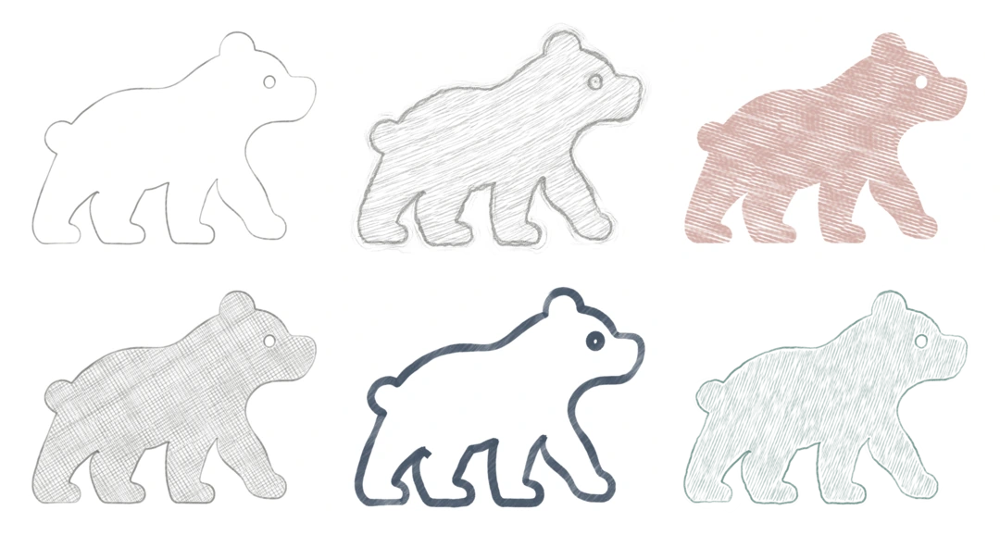

# Graphite

Graphite is a browser library for outlining and shading SVG artwork with brushes. Prepare your SVG once, choose a brush, then draw it to a canvas. You control the canvas size and can show the finished drawing or animate its layers.

This release includes the **Pencil** brush. It traces paths with pencil lines and shades with hatching. The renderer is designed to support multiple brushes. The package currently provides its own brushes through dedicated imports, and brush authoring is internal.

## Install

```sh
npm install @bareminimum/graphite
```

Use your browser bundler to resolve the imports. Graphite ships ES modules and TypeScript types. Preparing SVG artwork requires the DOM and Canvas 2D. Rendering with Pencil requires WebGL 2 and `EXT_color_buffer_float`.

For SVG-to-PNG rendering in a terminal, install [Graphite CLI](https://www.npmjs.com/package/@bareminimum/graphite-cli).

## Draw your first SVG

Add a canvas to your page:

```html
<canvas
  id="drawing"
  aria-label="A pencil drawing of a star"
  role="img"
></canvas>
```

In your browser entry point:

```js
import { createRenderer, prepareSvg } from "@bareminimum/graphite";
import { pencil } from "@bareminimum/graphite/pencil";

const canvas = document.querySelector("#drawing");
if (!(canvas instanceof HTMLCanvasElement)) throw new Error("Missing canvas");

const artwork = await prepareSvg(
  '<svg xmlns="http://www.w3.org/2000/svg" viewBox="0 0 100 100">' +
    '<path d="M50 5 62 37 96 38 69 59 78 92 50 73 22 92 31 59 4 38 38 37Z"/>' +
    "</svg>",
);

const renderer = createRenderer(canvas, {
  artwork,
  brush: pencil,
  width: 650,
  height: 500,
});
renderer.render();
```

`prepareSvg` takes SVG markup, so you can also fetch an SVG file and pass its text. Reuse the prepared artwork across draws or canvases. Call `renderer.dispose()` when you remove the canvas.

### Change the look

Pass a colour and brush settings to `render()`. Pencil can outline and shade independently.

```js
renderer.render({
  color: "#375750",
  style: {
    outline: { grade: -2, width: 0.3 },
    shading: { grade: 2, density: 0.6, angle: 65 },
  },
});
```

Each render starts from the brush defaults. Pass your settings again on the next draw. Set `outline.enabled` or `shading.enabled` to `false` to hide that layer. Pass an array of shading settings to stack hatches at different angles. The top-level `color` applies to the whole drawing.

## Showcase

### Pencil grades



Only the grade changes between swatches. Use integers from `-10` (10H) through `0` (HB) to `8` (8B). Pencil calibrates shading at the default drawing settings. Pressure, paper and other settings also affect the tone.

### Bear examples

The same bear SVG with six Pencil presets.



<details>
<summary>Copy the six render presets in sheet order</summary>

```js
const bearStyles = [
  {
    style: {
      paper: 0.15,
      outline: {
        grade: -5,
        passes: 1,
        width: 0.16,
        pressure: 0.8,
        wobble: 0,
        searchingLines: 0,
      },
      shading: {
        enabled: false,
      },
    },
  },
  {
    style: {
      paper: 0.72,
      outline: {
        grade: 1,
        passes: 2,
        width: 0.22,
        wobble: 0.92,
        searchingLines: 16,
        searchingPressure: 0.52,
        searchingSpread: 0.95,
        opacity: 0.68,
        pressure: 0.42,
      },
      shading: {
        grade: -2,
        pressure: 0.52,
        density: 0.24,
        width: 0.65,
        wobble: 0.82,
        angle: 27,
        arc: 0.6,
        strokeLength: 0.37,
        raggedness: 0.9,
      },
    },
  },
  {
    color: "#963e2d",
    style: {
      paper: 0.4,
      outline: {
        enabled: false,
      },
      shading: {
        grade: 2,
        pressure: 0.9,
        density: 0.22,
        width: 1,
        angle: 163,
        wobble: 0,
        arc: 0,
        overshoot: 0.04,
        raggedness: 0,
      },
    },
  },
  {
    style: {
      paper: 0.23,
      outline: {
        grade: -1,
        passes: 1,
        width: 0.18,
        wobble: 0,
        searchingLines: 0,
      },
      shading: [
        {
          grade: -2,
          angle: 32,
          density: 0.32,
          width: 0.48,
          wobble: 0,
          arc: 0,
          overshoot: -0.1,
          raggedness: 0.1,
        },
        {
          grade: 1,
          angle: 122,
          density: 0.22,
          width: 0.38,
          pressure: 0.53,
          wobble: 0,
          arc: 0,
          overshoot: -0.1,
          raggedness: 0.1,
        },
      ],
    },
  },
  {
    color: "#26364a",
    style: {
      paper: 0.28,
      outline: {
        grade: 3,
        pressure: 0.85,
        passes: 1,
        wobble: 0.08,
        width: 0.9,
        searchingLines: 0,
      },
      shading: {
        grade: -3,
        opacity: 0.48,
        angle: 3,
        density: 0.62,
        strokeLength: 0.55,
        overshoot: -0.1,
        arc: 0,
        wobble: 0.25,
      },
    },
  },
  {
    color: "#24564b",
    style: {
      paper: 0.58,
      outline: {
        grade: -1,
        opacity: 0.86,
        pressure: 0.68,
        width: 0.17,
        passes: 1,
        wobble: 0.33,
        searchingLines: 2,
        searchingPressure: 0.26,
      },
      shading: {
        grade: 1,
        pressure: 0.89,
        opacity: 1,
        width: 0.37,
        density: 0.4,
        strokeLength: 0.3,
        wobble: 0.29,
        angle: 70,
        arc: 0.25,
        overshoot: -0.1,
      },
    },
  },
];
// The presets run left to right, starting at the top row.
renderer.render(bearStyles[0]);
```

</details>

## Pencil settings

Pass these settings in `render({ style })`. `pencil.settings` provides the numeric defaults and ranges for controls such as sliders. Raw `shader` overrides are experimental.

| Setting                     | Default  | Range                  | Effect                                                                                                                                                                                                                        |
| --------------------------- | -------- | ---------------------- | ----------------------------------------------------------------------------------------------------------------------------------------------------------------------------------------------------------------------------- |
| `paper`                     | `0.5`    | 0–1                    | Paper tooth: smooth paper has a fine tooth that fills easily, rough paper the reverse                                                                                                                                         |
| `shading.enabled`           | `true`   | `true` or `false`      | Draws the shading. An empty `shading` list also draws none                                                                                                                                                                    |
| `shading.opacity`           | `1`      | 0–1                    | Caps the finished shading layer                                                                                                                                                                                               |
| `shading.grade`             | `0` (HB) | whole numbers −10 to 8 | The pencil: −10 is 10H, 0 is HB, 8 is 8B                                                                                                                                                                                      |
| `shading.pressure`          | `0.5`    | 0–1                    | How hard the pencil is pressed. Above 0.5, each 0.5 doubles the graphite; below, it falls to an eighth at 0, a light touch that only catches the paper's peaks                                                                |
| `shading.density`           | `0.5`    | 0–1                    | How closely strokes are hatched; lower leaves more paper between lines. Each step of 0.5 halves or doubles the spacing                                                                                                        |
| `shading.wobble`            | `0.5`    | 0–1                    | How unsteady the hand is: lines drift and shake, bunching in places and parting in others, where paper shows. 0 is ruled straight lines, 1 a shaky hand                                                                       |
| `shading.width`             | `0.5`    | 0–1                    | How wide each line is, from a fresh point (0, half as wide) to a blunt, worn one (1, twice as wide). Density spaces the lines, so broader lines leave narrower gaps                                                           |
| `shading.overshoot`         | `0.5`    | −1–1                   | How far the strokes run past the outline. 0 stops them under the line; −1 stops them well short of it, leaving a rim of bare paper                                                                                            |
| `shading.raggedness`        | `0.5`    | 0–1                    | How uneven the stroke ends are. 0 ends them along one smooth line, 1 very unevenly                                                                                                                                            |
| `shading.strokeLength`      | `1`      | 0–1                    | How long each stroke is before the hand lifts. 0 is short flicks; 1 is one stroke across the whole shape, never lifting. Strokes taper in and out, so shorter ones show their ends and short slivers of paper where they meet |
| `shading.arc`               | `0.2`    | −1–1                   | How much the strokes curve as the wrist pivots. 0 is straight; negative curves the other way                                                                                                                                  |
| `shading.angle`             | `45`     | 0–180                  | Hatching direction in degrees, counter-clockwise from horizontal                                                                                                                                                              |
| `outline.enabled`           | `true`   | `true` or `false`      | Draws the outline                                                                                                                                                                                                             |
| `outline.opacity`           | `0.9`    | 0–1                    | Caps the finished outline                                                                                                                                                                                                     |
| `outline.grade`             | `0` (HB) | whole numbers −10 to 8 | The line's pencil, chosen apart from the shading's. Its grain follows the grade as the shading's does; softer grades draw a darker, slightly wider line. The line's darkness is not matched to real pencil                    |
| `outline.pressure`          | `0.5`    | 0–1                    | How hard the line is pressed, on the same curve as `shading.pressure`                                                                                                                                                         |
| `outline.passes`            | `2`      | whole numbers 1 to 8   | How many lines the hand draws along the edge. Each has the full width and wobbles on its own: on top of each other they darken the line, with wobble they drift into a sketchy bundle                                         |
| `outline.wobble`            | `0.5`    | 0–1                    | How far each line strays from the edge on its own. 0 keeps every line close to the edge; on bold lines it grows with the width                                                                                                |
| `outline.width`             | `0.1`    | 0–1                    | How wide each line is: how blunt the point is. 0 is a hairline; 1 is a bold line about seven default lines wide                                                                                                               |
| `outline.searchingLines`    | `6`      | whole numbers 0 to 20  | How many light lines the hand draws to feel for the edge before it firms the line up. 0 draws only the firm line                                                                                                              |
| `outline.searchingPressure` | `0.5`    | 0–1                    | How hard the searching lines press. 0 leaves no mark; 1 presses as firmly as one pass of the line at the default pressure                                                                                                     |
| `outline.searchingSpread`   | `0.5`    | 0–1                    | How widely the searching strokes scatter around the final line. Each short stroke sits its own distance off the edge, the first lines furthest. 0 keeps them on it                                                            |

## Canvas sizing and cleanup

Your application chooses the canvas backing size with `width` and `height` in renderer options, or with `renderer.resize(width, height)` followed by `render()`. Omitted dimensions default to 975 × 750. Graphite maps a 650 × 500 artwork frame to your canvas, so use a 13:10 aspect ratio for the backing size and CSS layout to preserve proportions. Backing dimensions must be whole pixels from 1 to 8192, subject to the device's limits.

Use `createRenderer` for a dedicated WebGL canvas. For several drawings, create one `createRenderingSession()` and give each `session.createDrawing(canvas, options)` its own Canvas 2D target. The session shares a private WebGL context and copies each render to its target. Dispose drawings as they leave the page and dispose the session when you finish using it.

Preparation can reject, and renderer creation or drawing can throw. Handle these errors where you create and draw the canvas. If a shared session loses its context, it disposes its drawings and calls the optional `onContextLost` callback. Create a new session to recover. A replacement standalone renderer needs a fresh canvas.

## Animate a drawing

`render()` shows the finished drawing. Pass `progress` with a value from 0 to 1 for each layer to draw part of it. Your application supplies the clock and decides when to pause, replay or show the finished drawing.

```js
import { createDrawingTimeline } from "@bareminimum/graphite";

const timeline = createDrawingTimeline(pencil, { guides: 0 });
const start = performance.now();

function frame(now) {
  const elapsed = (now - start) / 1000;
  renderer.render({ progress: timeline.at(elapsed) });
  if (elapsed < timeline.duration) requestAnimationFrame(frame);
}

requestAnimationFrame(frame);
```

Set `layers` in the timeline options to override layer durations in seconds. Set `guides` to reserve time before the first layer. If you draw construction lines, `generateGuides(artwork)` from `@bareminimum/graphite/guides` returns SVG path data and timing fractions for an overlay. `createStrokeSequence` can also divide a phase among your own strokes.

## SVG input

Use trusted, self-contained monochrome SVGs with the SVG namespace. Graphite reads paths, basic shapes, transform attributes and local `use` references to shapes or groups. Flatten nested viewports and CSS-driven geometry, transforms or visibility, and convert text to paths. For line icons, try disabling shading so Pencil traces the paths without hatching their stroke area.

Graphite decodes SVGs through a blob URL. If your site uses a Content Security Policy, allow blob URLs for images.

## Worker preparation

Call `rasterizeSvg(markup)` on the main thread, then send the raster to a module worker. In the worker, call `prepareRaster(raster)`. To also precompute Pencil strokes for your chosen style, call `pencil.prepare(artwork, style)`. Send the result back with `postMessage(artwork, artworkBuffers(artwork))`. Transferring buffers detaches them from the sender.

You can import Graphite during server rendering. Call DOM-dependent preparation and rendering in the browser.

## Smudges

`renderSmudge(canvas, { path, size })` from `@bareminimum/graphite/pencil` draws a smudge along SVG path data on a Canvas 2D surface. `size` is the width in path units. An `OffscreenCanvas` lets you draw in a worker. The function resizes the canvas to the cropped mark and returns its position inside the full frame. This API is experimental.

## Development

Use Node.js 22.12 or later. Run `npm install`, then `npm test` to build and test the package. Run `npm run typecheck` to check types or `npm pack` to build a local tarball. The showcase images live with the source on GitHub. See the [source guide](src/README.md) for the rendering pipeline.

### Releases

Release Please opens a version and changelog PR from Conventional Commits on `main`. Merge that PR to create a GitHub release. In the repository’s Actions settings, allow GitHub Actions to create pull requests.

Publish the first version from its GitHub release tag using your npm account. Then configure [npm trusted publishing](https://docs.npmjs.com/trusted-publishers/) for this repository and `publish.yml`, with permission to publish directly. Set the GitHub Actions repository variable `NPM_AUTO_PUBLISH` to `true` to publish future releases automatically. You can also run **Publish to npm** manually with an existing release tag.
